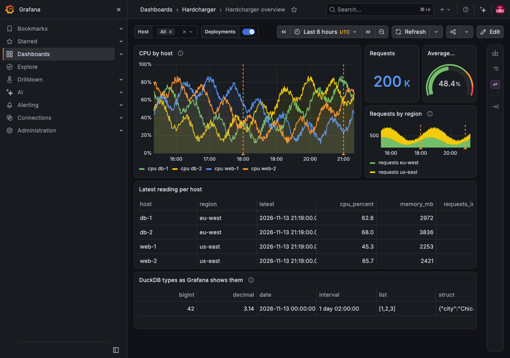
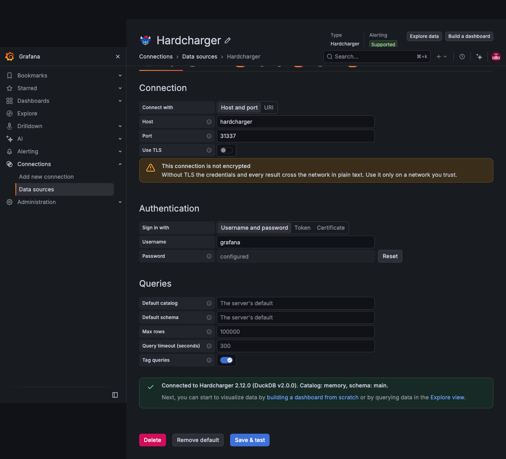
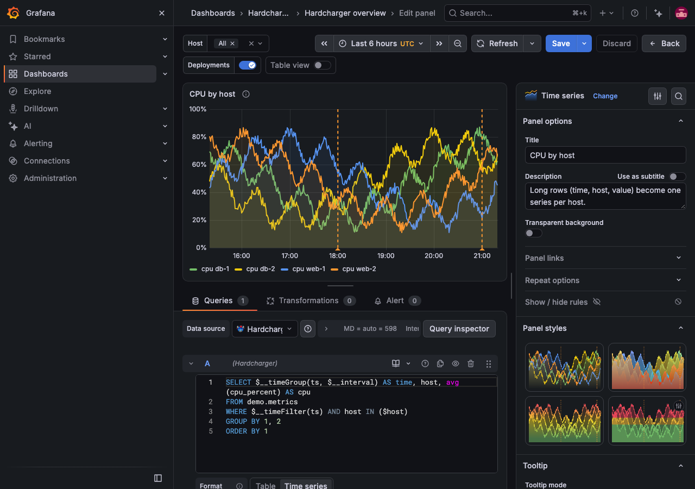

<p align="center">
  <a href="https://github.com/gizmodata/hardcharger">
    <picture>
      <source media="(prefers-color-scheme: dark)" srcset="https://raw.githubusercontent.com/gizmodata/grafana-hardcharger-datasource/main/docs/assets/hardcharger-banner-dark.png">
      
    </picture>
  </a>
</p>

<h1 align="center">Hardcharger™ Data Source for Grafana</h1>

<p align="center">
  <a href="https://github.com/gizmodata/grafana-hardcharger-datasource/actions/workflows/ci.yml"></a>
  <a href="https://github.com/gizmodata/grafana-hardcharger-datasource/releases/latest"></a>
  <a href="https://grafana.com"></a>
  <a href="https://github.com/gizmodata/hardcharger-adbc"></a>
  <a href="https://github.com/gizmodata/chargewire"></a>
  <a href="https://github.com/gizmodata/hardcharger"></a>
  <a href="https://github.com/gizmodata/grafana-hardcharger-datasource/blob/main/LICENSE"></a>
  <a href="https://gizmodata.com"></a>
</p>

<h3 align="center">Dashboards, alerts and Explore on Hardcharger: remote DuckDB 2.0, over Chargewire.</h3>

---

A [Grafana](https://grafana.com) data source for [Hardcharger™](https://gizmodata.com/hardcharger),
GizmoData™'s DuckDB 2.0 server. Queries are DuckDB SQL; they run on the server through the
[Hardcharger ADBC driver](https://github.com/gizmodata/hardcharger-adbc) over **Chargewire HTTP(S)**,
and the rows come back as Arrow.



- Dashboards, Explore, **alert rules**, **annotations** and **query variables**.
- **Table** and **Time series** formats: rows of (time, labels, values) become one series per label.
- **Macros** for the time range and for time buckets, with gap filling.
- TLS by default, a private CA, **mutual TLS**, and three ways to sign in.
- Every DuckDB type has a Grafana type chosen for it, and a `NULL` stays a `NULL`.
- A row cap and a query timeout that stop the statement **on the server**.
- Each statement is tagged on the server with the dashboard, panel and user it came from.

## Requirements

- Grafana **13.3 or later** (tested with 13.3.1), on Linux (x86-64, arm64), macOS (Intel, Apple
  silicon) or Windows (x86-64).
- A Hardcharger server (tested with 2.12.0) that Grafana's server can reach. The browser never
  talks to Hardcharger.

## Install

The plugin is **not signed yet**. Grafana refuses to load an unsigned plugin unless its id is
allowed in Grafana's configuration, so installing takes two steps: put the plugin in Grafana's
plugin directory, and allow it. Grafana Cloud does not load unsigned plugins at all.

### From a release zip

Download `gizmodata-hardcharger-datasource-<version>.zip` from the
[releases](https://github.com/gizmodata/grafana-hardcharger-datasource/releases), unpack it into
Grafana's plugin directory (`/var/lib/grafana/plugins` unless configured otherwise), allow the plugin
and restart Grafana:

```bash
unzip gizmodata-hardcharger-datasource-1.0.0.zip -d /var/lib/grafana/plugins
```

```ini
# grafana.ini
[plugins]
allow_loading_unsigned_plugins = gizmodata-hardcharger-datasource
```

The environment variable `GF_PLUGINS_ALLOW_LOADING_UNSIGNED_PLUGINS=gizmodata-hardcharger-datasource`
does the same as the `grafana.ini` setting.

Grafana's command line installs from the zip's URL as well:

```bash
grafana cli --pluginUrl https://github.com/gizmodata/grafana-hardcharger-datasource/releases/download/v1.0.0/gizmodata-hardcharger-datasource-1.0.0.zip plugins install gizmodata-hardcharger-datasource
```

### With Docker

```bash
unzip gizmodata-hardcharger-datasource-1.0.0.zip -d plugins
docker run --rm -p 3000:3000 \
  -v "$PWD/plugins/gizmodata-hardcharger-datasource:/var/lib/grafana/plugins/gizmodata-hardcharger-datasource" \
  -e GF_PLUGINS_ALLOW_LOADING_UNSIGNED_PLUGINS=gizmodata-hardcharger-datasource \
  grafana/grafana:13.3.1
```

## Configure

**Connections → Data sources → Add new data source → Hardcharger.** Everything can be changed after
the data source is saved.



| Setting | What it is |
| --- | --- |
| **Host**, **Port** | The server. An empty port is 31337, or 443 for a GizmoData Cloud host. |
| **Use TLS** | On unless you turn it off. Turn it off only for a server that runs without TLS. |
| **Connection URI** | Instead of host and port: `hardcharger://host[:port]` (TLS) or `hardcharger://host:port?tls=false`. Credentials do not go in the URI. |
| **Sign in with** | **Username and password**, an **access token** issued for the data source (the plugin cannot renew it), or the **client certificate** alone (the server must offer certificate sign-in). |
| **CA certificate** | PEM certificates to trust for the server certificate, for a private certificate authority. Empty: the system's. |
| **TLS server name** | The name the server certificate is checked against, when it is not the host. |
| **Client certificate**, **Client key** | PEM certificate chain and key for a server that asks for a client certificate (mutual TLS). |
| **Skip TLS verification** | Do not verify the server certificate. Development only. |
| **Default catalog**, **Default schema** | Where unqualified table names are looked up. The schema is one schema name in the catalog. Empty: the server's default. |
| **Max rows** | The most rows read from one query (100,000 unless set). |
| **Query timeout** | Seconds after which a query is cancelled on the server (300 unless set; 0: no limit). |
| **Tag queries** | Record Grafana's context with each statement (see [Query tags](#query-tags)). On unless you turn it off. |

The password, the token, the certificates and the key are stored encrypted by Grafana and are only
sent to the plugin's backend. **Save & test** signs in, runs a query and reports the server's
version, catalog and schema.

Give the data source a Hardcharger user that can only read what dashboards should show: anyone who
can edit a query in Grafana can run any SQL that user may run.

### Provisioning

A username and a password, with the password from the environment:

```yaml
apiVersion: 1

datasources:
  - name: Hardcharger
    type: gizmodata-hardcharger-datasource
    access: proxy
    jsonData:
      host: hardcharger.example.com
      port: 31337
      username: grafana_reader
      catalog: lake
      schema: reports
      maxRows: 50000
      queryTimeout: 60
    secureJsonData:
      password: $HARDCHARGER_PASSWORD
```

A private certificate authority and sign-in with a client certificate, from files:

```yaml
apiVersion: 1

datasources:
  - name: Hardcharger (mTLS)
    type: gizmodata-hardcharger-datasource
    access: proxy
    jsonData:
      uri: hardcharger://hardcharger.example.com:31337
      authType: client_certificate
    secureJsonData:
      tlsCACert: $__file{/etc/grafana/tls/ca.pem}
      tlsClientCert: $__file{/etc/grafana/tls/client.pem}
      tlsClientKey: $__file{/etc/grafana/tls/client-key.pem}
```

| `jsonData` | | `secureJsonData` | |
| --- | --- | --- | --- |
| `uri` | Connection URI; wins over `host`, `port`, `useTLS` | `password` | |
| `host`, `port` | | `token` | Access token |
| `useTLS` | `false` for a server without TLS | `tlsCACert` | PEM |
| `authType` | `password` (default), `token`, `client_certificate` | `tlsClientCert` | PEM |
| `username` | | `tlsClientKey` | PEM |
| `tlsServerName`, `tlsSkipVerify` | | | |
| `catalog`, `schema` | | | |
| `maxRows`, `queryTimeout`, `tagQueries` | | | |

## Query



Write DuckDB SQL. The query runs when the editor loses focus, and on Ctrl/Cmd+S. Each query runs in
a session of its own, so a `USE` or `SET` in one query does not reach another.

**Table** returns the rows as they are. **Time series** needs a time column and at least one number
column:

- The time column is the first `DATE` or `TIMESTAMP` column, or a number column named `time` holding
  a Unix epoch (seconds, milliseconds, microseconds or nanoseconds, told apart by size). A `NULL`
  time is an error. Rows need not be ordered.
- Every text (or boolean) column is a **label**: each number column becomes one series per
  combination of label values.

```sql
SELECT $__timeGroup(ts, $__interval) AS time, host, avg(cpu_percent) AS cpu
FROM demo.metrics
WHERE $__timeFilter(ts)
GROUP BY 1, 2
ORDER BY 1
```

### Macros

| Macro | Becomes |
| --- | --- |
| `$__timeFilter(column)` | `column >= '<from>' AND column <= '<to>'` |
| `$__timeFrom()`, `$__timeTo()` | `'2026-11-13T10:00:00.000Z'`: the ends of the time range, UTC |
| `$__timeGroup(column, interval[, fill])` | `time_bucket(INTERVAL '<n> seconds', column)` |
| `$__timeGroupAlias(column, interval[, fill])` | the same, `AS "time"` |
| `$__unixEpochFilter(column)` | `column >= <from> AND column <= <to>`, in Unix seconds |
| `$__unixEpochFrom()`, `$__unixEpochTo()` | the ends of the time range in Unix seconds |
| `$__unixEpochGroup(column, interval[, fill])` | `CAST(floor((column) / <n>) * <n> AS BIGINT)` |
| `$__unixEpochGroupAlias(column, interval[, fill])` | the same, `AS "time"` |
| `$__interval`, `$__interval_ms` | the panel's interval: `30s`, `30000` |
| `$__from`, `$__to` | the ends of the time range in epoch milliseconds |

- The time literals are text that DuckDB casts to the column's type, so `$__timeFilter` works on
  `TIMESTAMP`, `TIMESTAMPTZ` and `DATE` columns. A `TIMESTAMP` without a time zone is read as UTC,
  here and when its values are shown.
- An **interval** is `30s`, `5m`, `1h`, `1d`, `1w`, `1M`, `1y` or `$__interval`. Buckets of fixed
  length are aligned to UTC whatever the server's time zone; months and years are calendar buckets.
- A **fill** (`NULL`, `previous` or a number) fills the buckets the query returned no rows for, in
  the Time series format: `$__timeGroup(ts, 5m, 0)`. It needs an interval of fixed length.
- Macros are found in the SQL's code only. In a string, a quoted identifier or a comment they are
  left as they are, so write `to_milliseconds($__interval_ms)`, not `INTERVAL '$__interval_ms ms'`.
- `$__timeFrom`, `$__timeTo` and `$__timeFilter` also work without parentheses, as in the GizmoSQL
  data source (`$__timeFilter` then filters a column named `time`).
- A misspelt macro is an error that lists the macros, not SQL sent to the server.

### Variables

A dashboard variable is written into the SQL **as a literal**, so its value can only ever be a
value, never SQL:

| Variable holds | `$var` becomes | Use it as |
| --- | --- | --- |
| `web-1` | `'web-1'` | `WHERE host = $host` |
| `25` | `25` | `LIMIT $limit` |
| `web-1` and `o'neil` (multi-value) | `'web-1','o''neil'` | `WHERE host IN ($host)` |
| nothing selected | `NULL` | `WHERE host IN ($host)` matches nothing |

Do not put quotes around a variable: `'$host'` becomes `''web-1''`. This differs from Grafana's
PostgreSQL and MySQL data sources, where a single value is written without quotes. To write a
variable unquoted (a table or column name, part of a pattern), use `${var:raw}`; that is then
yours to keep safe. A value is a number only when it is written plainly (`25`, `-0.5`); `007` and
`1e5` stay text.

A **query variable**'s options are every value its SQL returns. For labels that differ from the
values, name the columns `__text` and `__value`:

```sql
SELECT DISTINCT upper(region) AS __text, region AS __value FROM demo.metrics ORDER BY 1
```

### Annotations and alerting

An **annotation** query returns the events: a `time` column, optionally `timeEnd`, and `text`,
`title` and `tags` (comma-separated) columns.

```sql
SELECT ts AS time, message AS text, tags FROM demo.events WHERE $__timeFilter(ts)
```

**Alert rules** use the same queries. Grafana's server evaluates them without a browser, and the
macros (also `$__interval`) expand there as they do in a dashboard.

## Types

| DuckDB | Grafana | |
| --- | --- | --- |
| `BOOLEAN` | boolean | |
| `TINYINT` … `BIGINT`, `UTINYINT` … `UBIGINT` | number | the same integer type |
| `FLOAT`, `DOUBLE` | number | |
| `DECIMAL`, `HUGEINT`, `UHUGEINT`, `BIGNUM` | number | the nearest 64-bit float; `CAST(x AS VARCHAR)` for every digit |
| `VARCHAR`, `UUID`, `ENUM`, `JSON` | string | |
| `BLOB` | string | hexadecimal |
| `BIT` | string | DuckDB's bytes in hexadecimal; `CAST(x AS VARCHAR)` for `0101` |
| `DATE` | time | midnight UTC |
| `TIMESTAMP`, `TIMESTAMP_S`, `_MS`, `_NS` | time | read as UTC |
| `TIMESTAMPTZ` | time | |
| `TIME`, `TIME_NS` | string | `01:02:03.5` |
| `TIMETZ` | string | the time of day; the server sends no offset |
| `INTERVAL` | string | as DuckDB prints it: `1 year 2 months 3 days 04:00:00` |
| `LIST`, `ARRAY`, `STRUCT`, `MAP`, `UNION`, `VARIANT` | string | JSON: `[1,2,3]`, `{"a":1}`, a union as `{"member":value}` |
| `GEOMETRY` | string | well-known text: `POINT (1 2)` |
| `NULL` (an untyped column) | number | all `NULL` |

Every column is nullable, and a `NULL` is an empty cell or a gap, never `0`, `false` or an empty
string. A column whose Arrow type has no mapping fails the query with an error that names the
column and the type; nothing is turned into text by guessing.

When the server runs with DuckDB's `arrow_lossless_conversion`, `HUGEINT`, `UHUGEINT`, `UUID`,
`BIT` (then `0101`) and `TIMETZ` (then with its offset, `01:02:03+02`) arrive as DuckDB's own Arrow
types, which the plugin reads too.

## Query tags

Unless **Tag queries** is off, each statement carries a query tag, which Hardcharger records with
the statement (`hardcharger_live_queries()`, its instrumentation tables):

```json
{"app":"grafana","dashboard_uid":"hardcharger-overview","datasource_uid":"hardcharger-dev","namespace":"default","panel_id":"1","plugin":"gizmodata-hardcharger-datasource","ref_id":"A","user":"admin"}
```

`user` is the Grafana login of whoever ran the query. An alert rule's statements carry
`"from_alert":true` and the rule's `rule_uid`, with Grafana's scheduler as the user.

## Errors

A query that fails shows the server's own message. To Grafana it is the query's failure (source
`downstream`) unless the plugin itself failed:

| Status | |
| --- | --- |
| 400 | The SQL, a macro, a setting, the Time series format's requirements |
| 401, 403 | The server refused the credentials, or denied the statement |
| 408 | The query ran into the query timeout and was cancelled |
| 502 | The server could not be reached, or reported an internal error |
| 500, 501 | A fault of the plugin; an Arrow type without a mapping |

Passwords, tokens, keys and credentials in a URI never appear in an error or in Grafana's log.

## Limits

- **One statement's rows at a time.** A query is cut off at **Max rows**, with a notice on the
  panel; aggregate on the server (`$__timeGroup`) rather than sending raw rows.
- **Numbers are 64-bit floats in the browser.** Integers beyond 2^53 and long decimals lose digits
  on the way to a panel; cast them to `VARCHAR` when every digit matters.
- **A `DATE` is midnight UTC.** A dashboard in a time zone west of UTC shows it as the evening
  before; set the dashboard's time zone to UTC, or cast the date to `VARCHAR`.
- **No query builder, no table browser:** queries are written as SQL.
- **No browser sign-in.** The plugin's backend signs in; a data source has one identity for all its
  users, and Hardcharger's access control applies to that identity.
- **A stopped GizmoData Cloud cluster starts when a query arrives.** A dashboard that refreshes, or
  an alert rule, keeps it running.
- **Writes are not blocked** by the plugin: use a read-only user.

## Development

```bash
npm install
npm run build                 # the frontend, into dist/
npm run build:backend         # the backend for every platform, into dist/
docker compose up --build     # Hardcharger with sample data, and Grafana on http://localhost:3000
```

The stack provisions a data source and the **Hardcharger overview** dashboard over sample data that
the server generates itself. [CLAUDE.md](https://github.com/gizmodata/grafana-hardcharger-datasource/blob/main/CLAUDE.md)
has every build and test command.

## License

[Apache License 2.0](https://github.com/gizmodata/grafana-hardcharger-datasource/blob/main/LICENSE).
Hardcharger™ and GizmoData™ are trademarks of GizmoData LLC.
